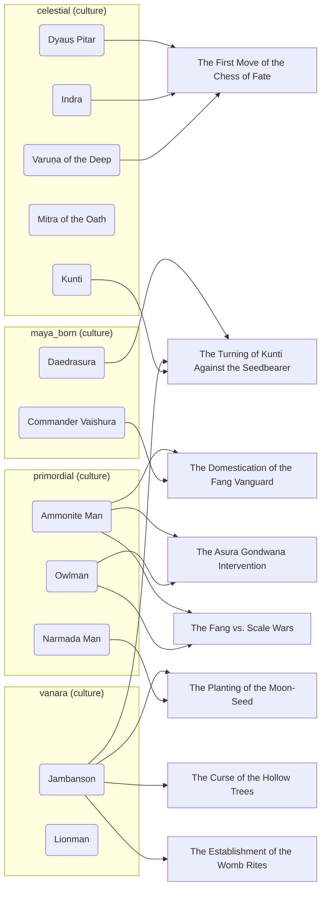
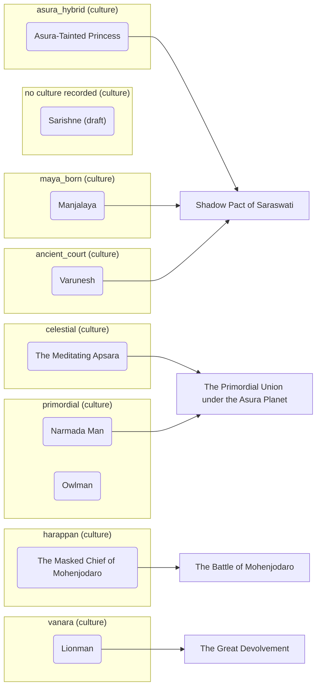
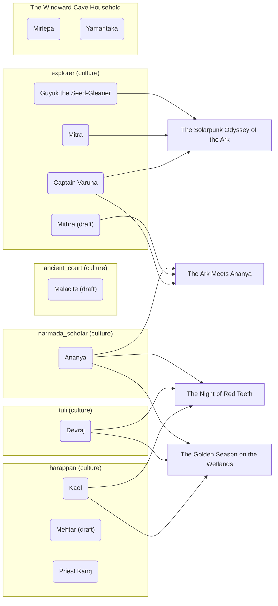
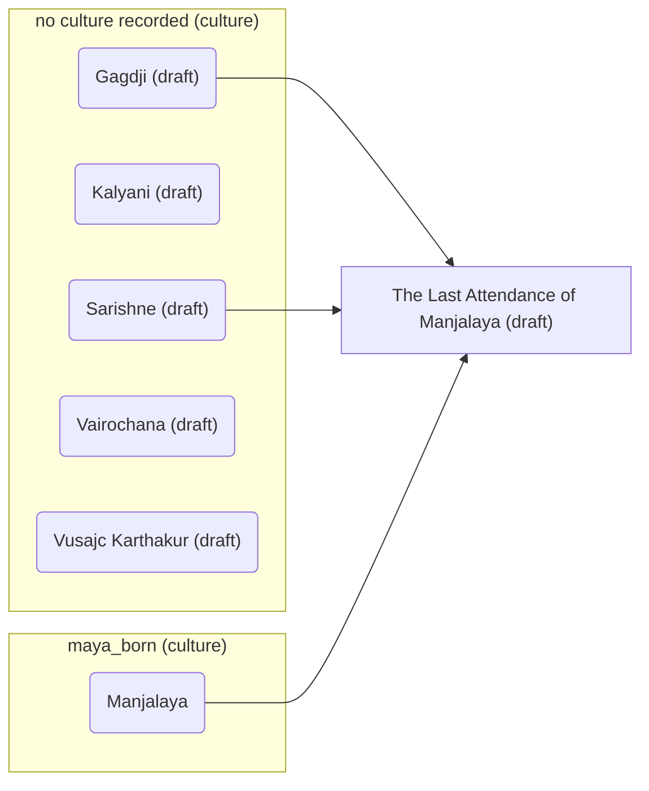

# The Memory Map

<a href="https://lordlebu.github.io/SouthOfTethys/">The Timeline</a> &middot; <a href="https://lordlebu.github.io/SouthOfTethys/timeline_mermaid.html">Epochs &amp; Events</a> &middot; <a href="https://lordlebu.github.io/SouthOfTethys/atlas.html">The Atlas</a> &middot; <strong>The Memory Map</strong> &middot; <a href="https://lordlebu.github.io/SouthOfTethys/bestiary.html">The Bestiary</a> &middot; <a href="https://lordlebu.github.io/SouthOfTethys/cookbook.html">The Cookbook</a>

*Generated by `utils/generate_memory_map.py`. Do not edit by hand.*

Who canon remembers, one era at a time: the people, the events they were present at,
and the factions and cultures that hold them. The timeline says when and the atlas says
where; this says who.

Grouping is by faction where someone has one and by culture otherwise, because a person
has both and the boxes cannot overlap. A character who appears in no event yet still
draws, unconnected, rather than being left out.
The unassigned section lists undated people and events. Links show recorded attendance.

## Prehistoric Foundations & Age of Vanaras

12 character(s), 8 event(s) they appear in, 4 group(s).

**Present in no event of this era:** Lionman, Mitra of the Oath.

## Deep Antiquity

9 character(s), 4 event(s) they appear in, 8 group(s).

**Present in no event of this era:** Owlman, Sarishne.

## Era of Human Migrations

```mermaid
graph LR
  subgraph grp_celestial["celestial (culture)"]
    character_meditating_apsara("The Meditating Apsara")
  end
  subgraph grp_explorer["explorer (culture)"]
    character_guyuk("Guyuk")
  end
  subgraph grp_harappan["harappan (culture)"]
    character_orek("Orek")
    character_sira("Sira")
    character_thren("Thren")
    character_vara_ma("Vara-Ma")
  end
  subgraph grp_jharwa["jharwa (culture)"]
    character_jharwa_elder_repa("Elder Repa")
    character_meera("Meera")
  end
  subgraph grp_maya_born["maya_born (culture)"]
    character_manjalaya("Manjalaya")
  end
  subgraph grp_no_culture_recorded["no culture recorded (culture)"]
    character_aryaman("Aryaman (draft)")
    character_bhaga("Bhaga (draft)")
    character_divodasa("Divodāsa (draft)")
    character_ila("Ilā (draft)")
    character_narada("Nārada (draft)")
    character_pusan("Pūṣan (draft)")
    character_sarishne("Sarishne (draft)")
    character_savitr("Savitṛ (draft)")
    character_sudas("Sudās (draft)")
    character_tvastr("Tvaṣṭṛ (draft)")
    character_vaisvanara("Vaiśvānara (draft)")
    character_vasistha("Vasiṣṭha (draft)")
    character_vivasvan("Vivasvān (draft)")
    character_visvamitra("Viśvāmitra (draft)")
    character_vac("Vāc (draft)")
    character_vata("Vāta (draft)")
    character_wiznu("Wiznu the Strider (draft)")
  end
  subgraph grp_primordial["primordial (culture)"]
    character_ammonite_man("Ammonite Man")
    character_narmada_man("Narmada Man")
    character_owlman("Owlman")
  end
  subgraph grp_vedda["vedda (culture)"]
    character_bela("Bela")
    character_kashyapa("Kashyapa")
    character_ranu("Ranu")
  end
  subgraph grp_wanderer["wanderer (culture)"]
    character_nirigili("Nirigili")
  end
  event_aravali_massacre["Aravali Massacre & Sanctuary"]
  event_battle_of_ten_kings["Battle of Ten Kings (draft)"]
  event_botai_cattle_raid["The Botai Cattle Raid"]
  event_dispute_over_inherited_household_obligations["Dispute over Inherited Household Obligations (draft)"]
  event_divodasa_frontier_court["Divodāsa and the Frontier Court (draft)"]
  event_guyuk_narmada_apothecary_quest["The Narmada Apothecary Herb Quest"]
  event_jharwa_first_wave_shell_pact["The Jharwa First-Wave & The Shell Pact"]
  event_narada_travelling_witness_tradition["Nārada and the Travelling Witnesses (draft)"]
  event_naraka_portal["Opening of the Naraka Lok Portal"]
  event_retreat_of_owlman["The Retreat of Owlman"]
  event_sarishne_manjalaya_gate_disturbance["Sarishne Encounters Manjalaya at a Gate Disturbance (draft)"]
  event_sudas_river_passage["River Passage of the Bharata Force (draft)"]
  event_vasistha_court_recitals["Victory Recitals at the Bharata Court (draft)"]
  event_visvamitra_lays_down_his_seat["Viśvāmitra Lays Down His Seat (draft)"]
  event_wiznu_aryaman_appeal_to_indr["Wiznu and Aryaman Appeal to the Thunder-Bearer (draft)"]
  character_ammonite_man --> event_jharwa_first_wave_shell_pact
  character_aryaman --> event_wiznu_aryaman_appeal_to_indr
  character_bela --> event_aravali_massacre
  character_divodasa --> event_divodasa_frontier_court
  character_guyuk --> event_botai_cattle_raid
  character_guyuk --> event_guyuk_narmada_apothecary_quest
  character_guyuk --> event_naraka_portal
  character_ila --> event_dispute_over_inherited_household_obligations
  character_jharwa_elder_repa --> event_jharwa_first_wave_shell_pact
  character_manjalaya --> event_sarishne_manjalaya_gate_disturbance
  character_meera --> event_aravali_massacre
  character_narada --> event_narada_travelling_witness_tradition
  character_narmada_man --> event_guyuk_narmada_apothecary_quest
  character_nirigili --> event_botai_cattle_raid
  character_nirigili --> event_guyuk_narmada_apothecary_quest
  character_nirigili --> event_naraka_portal
  character_orek --> event_aravali_massacre
  character_owlman --> event_retreat_of_owlman
  character_ranu --> event_aravali_massacre
  character_sarishne --> event_sarishne_manjalaya_gate_disturbance
  character_sira --> event_aravali_massacre
  character_sudas --> event_battle_of_ten_kings
  character_sudas --> event_sudas_river_passage
  character_sudas --> event_vasistha_court_recitals
  character_thren --> event_aravali_massacre
  character_vac --> event_dispute_over_inherited_household_obligations
  character_vara_ma --> event_aravali_massacre
  character_vasistha --> event_vasistha_court_recitals
  character_visvamitra --> event_sudas_river_passage
  character_visvamitra --> event_visvamitra_lays_down_his_seat
  character_vivasvan --> event_dispute_over_inherited_household_obligations
  character_wiznu --> event_wiznu_aryaman_appeal_to_indr
```

33 character(s), 15 event(s) they appear in, 9 group(s).

**Present in no event of this era:** Bhaga, Kashyapa, Pūṣan, Savitṛ, The Meditating Apsara, Tvaṣṭṛ, Vaiśvānara, Vāta.

## Civilization Dawn (Lothal Era)

```mermaid
graph LR
  subgraph grp_cosmic["cosmic (culture)"]
    character_radiant_gentleman("The Radiant Gentleman")
  end
  subgraph grp_explorer["explorer (culture)"]
    character_guyuk("Guyuk")
    character_rathak("Rathak")
    character_ruvan("Ruvan")
  end
  subgraph grp_harappan["harappan (culture)"]
    character_priest_king_harappa("The remembered Priest-King")
  end
  subgraph grp_harappan_kia["harappan_kia (culture)"]
    character_sarita("Sarita")
  end
  subgraph grp_lundish["lundish (culture)"]
    character_elara_voss("Elara Voss")
  end
  subgraph grp_maya_born["maya_born (culture)"]
    character_daedrasura("Daedrasura")
  end
  subgraph grp_no_culture_recorded["no culture recorded (culture)"]
    character_aurva("Aurva (draft)")
    character_urva("Urva (draft)")
  end
  subgraph grp_polynesian_khmer["polynesian_khmer (culture)"]
    character_naga_raja("Naga-Raja")
  end
  subgraph grp_primordial["primordial (culture)"]
    character_narmada_man("Narmada Man")
  end
  subgraph grp_tamralinga["tamralinga (culture)"]
    character_vijaya("Vijaya")
  end
  subgraph grp_tuli["tuli (culture)"]
    character_korran_driftwood_seer("Korran Driftwood Seer")
    character_lirael_wavecaller("Lirael Wavecaller")
    character_sirael_thorncurrent("Sirael Thorncurrent")
  end
  subgraph grp_unknown["unknown (culture)"]
    character_the_traveler("The Traveler")
  end
  subgraph grp_yaksha["yaksha (culture)"]
    character_kubera("Kubera")
    character_yaksha_envoy("Yaksha Envoy (draft)")
  end
  subgraph grp_kia_clan["Kia Clan"]
    character_arin("Arin")
    character_khadi("Khadi")
    character_mira("Mira")
    character_nila("Nila")
  end
  subgraph grp_mask_family["Mask Family"]
    character_asha("Aasha")
    character_kavik("Kavik")
    character_mehme("Mehme")
    character_shaashak("Shaashak")
    character_iknaya("iKnaya")
  end
  subgraph grp_silvershore_dynasty["Silvershore Dynasty"]
    character_jarek("Jarek")
    character_lira("Lira")
    character_torin("Torin")
    character_varna("Varna")
  end
  event_aurva_garudasaur_blood_teaching["Aurva and the Garudasaur Blood Tradition (draft)"]
  event_awakening_mask_of_varkesh["The Awakening of the Mask of Vaṛkesh"]
  event_birth_of_sarita["Birth of Sarita Silversong"]
  event_black_lotus_siege["Black Lotus Siege"]
  event_exile_of_shaashak["Exile of Shaashak and Khadi"]
  event_final_voyage_of_the_kelpfang["The Final Voyage of the Kelpfang"]
  event_founding_lothal["Founding of Lothal"]
  event_guyuk_konkan_prophecy["The Wandering of the Narmada Seed-Mind"]
  event_guyuk_lothal_warning["The Storm-Bone Khan's Warning at Lothal"]
  event_mask_retrieval["Retrieval of the Mask of Harappa"]
  event_silvershore_war["Silvershore War"]
  event_stone_pact["The Stone Pact"]
  event_tendua_crisis["Tendua Crisis and Assassination of Kavik"]
  event_urva_eastern_bhrgu_teaching["Urva and the Eastern Bhṛgu Teaching Succession (draft)"]
  character_arin --> event_mask_retrieval
  character_arin --> event_stone_pact
  character_arin --> event_tendua_crisis
  character_asha --> event_awakening_mask_of_varkesh
  character_asha --> event_exile_of_shaashak
  character_asha --> event_mask_retrieval
  character_asha --> event_tendua_crisis
  character_aurva --> event_aurva_garudasaur_blood_teaching
  character_elara_voss --> event_final_voyage_of_the_kelpfang
  character_guyuk --> event_guyuk_konkan_prophecy
  character_guyuk --> event_guyuk_lothal_warning
  character_iknaya --> event_exile_of_shaashak
  character_iknaya --> event_mask_retrieval
  character_jarek --> event_silvershore_war
  character_kavik --> event_black_lotus_siege
  character_kavik --> event_founding_lothal
  character_kavik --> event_silvershore_war
  character_kavik --> event_stone_pact
  character_kavik --> event_tendua_crisis
  character_khadi --> event_birth_of_sarita
  character_khadi --> event_exile_of_shaashak
  character_khadi --> event_stone_pact
  character_khadi --> event_tendua_crisis
  character_korran_driftwood_seer --> event_final_voyage_of_the_kelpfang
  character_lirael_wavecaller --> event_final_voyage_of_the_kelpfang
  character_mehme --> event_guyuk_lothal_warning
  character_mehme --> event_mask_retrieval
  character_mehme --> event_tendua_crisis
  character_mira --> event_mask_retrieval
  character_mira --> event_stone_pact
  character_mira --> event_tendua_crisis
  character_naga_raja --> event_black_lotus_siege
  character_narmada_man --> event_guyuk_konkan_prophecy
  character_nila --> event_stone_pact
  character_nila --> event_tendua_crisis
  character_radiant_gentleman --> event_final_voyage_of_the_kelpfang
  character_rathak --> event_black_lotus_siege
  character_ruvan --> event_tendua_crisis
  character_sarita --> event_birth_of_sarita
  character_shaashak --> event_awakening_mask_of_varkesh
  character_shaashak --> event_birth_of_sarita
  character_shaashak --> event_exile_of_shaashak
  character_shaashak --> event_guyuk_lothal_warning
  character_shaashak --> event_stone_pact
  character_shaashak --> event_tendua_crisis
  character_sirael_thorncurrent --> event_final_voyage_of_the_kelpfang
  character_the_traveler --> event_final_voyage_of_the_kelpfang
  character_torin --> event_silvershore_war
  character_urva --> event_urva_eastern_bhrgu_teaching
  character_varna --> event_black_lotus_siege
  character_varna --> event_exile_of_shaashak
  character_varna --> event_mask_retrieval
  character_vijaya --> event_tendua_crisis
  character_yaksha_envoy --> event_tendua_crisis
```

32 character(s), 14 event(s) they appear in, 16 group(s).

**Present in no event of this era:** Daedrasura, Kubera, Lira, The remembered Priest-King.

## The Age of Machinery

```mermaid
graph LR
  subgraph grp_explorer["explorer (culture)"]
    character_varuna("Captain Varuna")
    character_mitra("Mitra")
  end
  subgraph grp_harappan["harappan (culture)"]
    character_kael("Kael")
    character_kavi("Kavi")
  end
  subgraph grp_kia["kia (culture)"]
    character_agasthya("Agasthya (draft)")
  end
  subgraph grp_narmada_scholar["narmada_scholar (culture)"]
    character_ananya("Ananya")
    character_digha_jani("Digha Jani")
    character_onko("Onko")
    character_shakariman("Shakariman")
  end
  subgraph grp_no_culture_recorded["no culture recorded (culture)"]
    character_bada_deo("Bada Deo (draft)")
    character_dharani_penu("Dharani Penu (draft)")
    character_donyi("Donyi (draft)")
    character_jaher_era("Jaher Era (draft)")
    character_jangubai("Jangubai (draft)")
    character_kupar_lingo("Kupar Lingo (draft)")
    character_leimarel_sidabi("Leimarel Sidabi (draft)")
    character_marang_buru("Marang Buru (draft)")
    character_niyam_raja("Niyam Raja (draft)")
    character_pakhangba("Pakhangba (draft)")
    character_polo("Polo (draft)")
    character_saljong("Saljong (draft)")
    character_sanamahi("Sanamahi (draft)")
    character_singbonga("Singbonga (draft)")
    character_tatara_rabuga("Tatara-Rabuga (draft)")
    character_shenrab("Tonpa Shenrab (draft)")
    character_tokisy("Tökisy (draft)")
    character_u_blei_nongthaw("U Blei Nongthaw (draft)")
    character_u_ryngkew("U Ryngkew (draft)")
  end
  subgraph grp_outlier["outlier (culture)"]
    character_aurum_theophanes("Aurum Theophanes (draft)")
  end
  subgraph grp_primordial["primordial (culture)"]
    character_ammonite_man("Ammonite Man")
  end
  subgraph grp_tuli["tuli (culture)"]
    character_devraj("Devraj")
  end
  event_agasthya_yaksha_southern_exchange["Agasthya’s Southern Exchange with the Yakshas (draft)"]
  event_antarctic_ice_wall_expedition["The Antarctic Ice Wall Expedition"]
  event_delta_custodians_embankment_repair["Delta Embankment Repair and Relief Settlement (draft)"]
  event_eastern_hill_seed_exchange["Eastern Seed Reserve Negotiations (draft)"]
  event_furnace_houses_forge_compact["Compact of the Furnace Houses (draft)"]
  event_gondwana_teleportation["The Gondwana Spacetime Teleportation"]
  event_ground_breaks_at_great_junction["The Day the Ground Broke at the Great Junction"]
  event_grove_obligations_enter_legal_roll["Grove and Hill Obligations Enter a Legal Roll (draft)"]
  event_hill_assembly_marks_spring_access["Hill Assembly Affirms Common Spring Access (draft)"]
  event_narmada_upriver_expedition["The Narmada Upriver Expedition"]
  event_ridge_path_landslip_hearing["Highland Hearing at the Landslip (draft)"]
  event_shenrab_winter_passage_agreement["Highland Winter Passage Agreement (draft)"]
  event_tokisy_shared_pasture_agreement["Nilgiri Shared Pasture Agreement (draft)"]
  event_upland_watershed_quarry_pact["Upland Watershed Quarry Pact (draft)"]
  event_village_keeps_two_seasonal_reckonings["Debate over a Shared Seasonal Reckoning (draft)"]
  character_agasthya --> event_agasthya_yaksha_southern_exchange
  character_ammonite_man --> event_antarctic_ice_wall_expedition
  character_ananya --> event_ground_breaks_at_great_junction
  character_bada_deo --> event_furnace_houses_forge_compact
  character_devraj --> event_ground_breaks_at_great_junction
  character_dharani_penu --> event_upland_watershed_quarry_pact
  character_digha_jani --> event_gondwana_teleportation
  character_digha_jani --> event_narmada_upriver_expedition
  character_donyi --> event_village_keeps_two_seasonal_reckonings
  character_jaher_era --> event_grove_obligations_enter_legal_roll
  character_jangubai --> event_furnace_houses_forge_compact
  character_kael --> event_ground_breaks_at_great_junction
  character_kupar_lingo --> event_furnace_houses_forge_compact
  character_leimarel_sidabi --> event_delta_custodians_embankment_repair
  character_marang_buru --> event_grove_obligations_enter_legal_roll
  character_mitra --> event_antarctic_ice_wall_expedition
  character_niyam_raja --> event_upland_watershed_quarry_pact
  character_onko --> event_gondwana_teleportation
  character_onko --> event_narmada_upriver_expedition
  character_pakhangba --> event_delta_custodians_embankment_repair
  character_polo --> event_village_keeps_two_seasonal_reckonings
  character_saljong --> event_eastern_hill_seed_exchange
  character_sanamahi --> event_delta_custodians_embankment_repair
  character_shenrab --> event_shenrab_winter_passage_agreement
  character_singbonga --> event_grove_obligations_enter_legal_roll
  character_tatara_rabuga --> event_eastern_hill_seed_exchange
  character_tokisy --> event_tokisy_shared_pasture_agreement
  character_u_blei_nongthaw --> event_hill_assembly_marks_spring_access
  character_u_ryngkew --> event_ridge_path_landslip_hearing
  character_varuna --> event_antarctic_ice_wall_expedition
```

31 character(s), 15 event(s) they appear in, 8 group(s).

**Present in no event of this era:** Aurum Theophanes, Kavi, Shakariman.

## Post-Cataclysmic Era (The Great Shattering)

12 character(s), 4 event(s) they appear in, 6 group(s).

**Present in no event of this era:** Malacite, Mehtar, Mirlepa, Priest Kang, Yamantaka.

## Epoch Unassigned

6 character(s), 1 event(s) they appear in, 2 group(s).

**Present in no event of this era:** Kalyani, Vairochana, Vusajc Karthakur.
